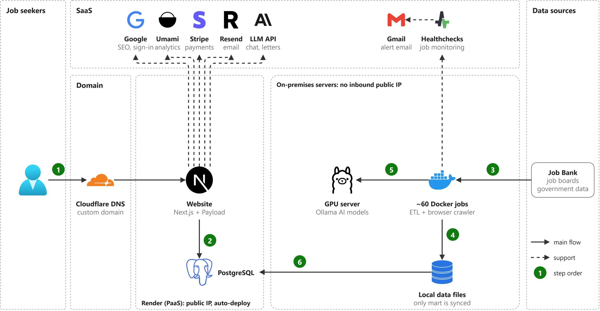
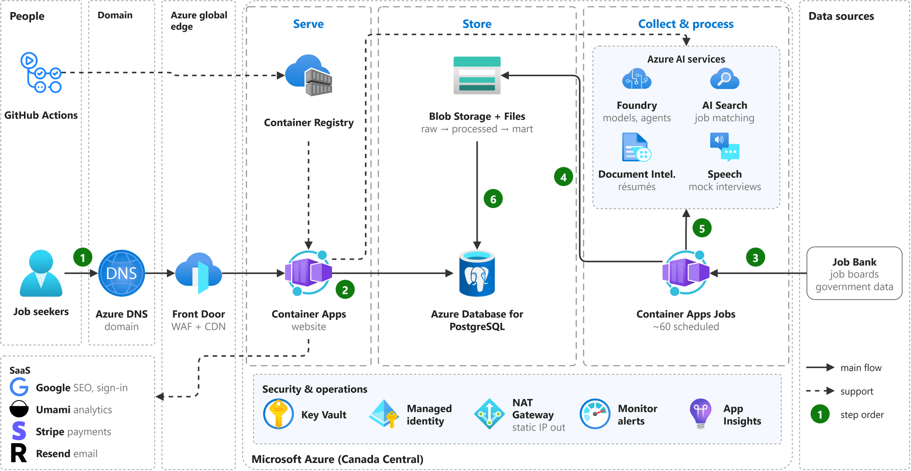
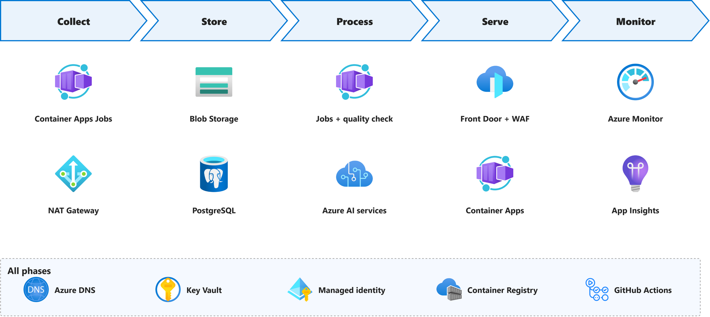
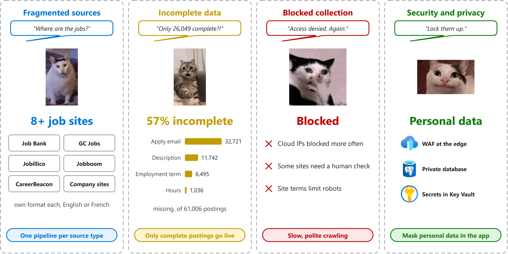
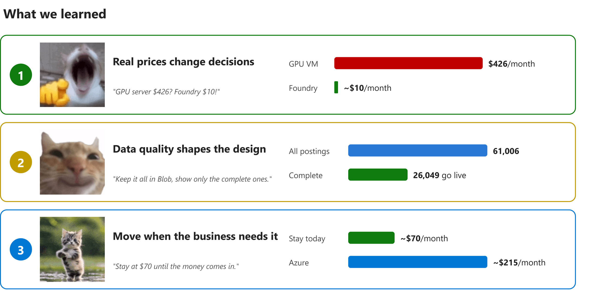

# Group Presentation 1: Cloud-Based Job Search and Analytics Platform

| | |
|---|---|
| Course | CST8912 Cloud Solutions Architecture, Section 011 |
| Professor | Ragini Madaan |
| Group | CST8912 011 - 1 |
| Members | David Yin, Hye Ran (Lannie) Yoo, Naol Meherete, Peng (Frank) Wang, Tao Lu |
| Presentation date | 2026-10-22 (Week 7) |
| Research topic | Cloud-Based Job Search and Analytics Platform (approved by email in September) |
| Use case | Our job platform (offer2pr), moved to Microsoft Azure |

**Presenters:** not chosen yet; 10 slides, two per speaker.

| # | Slide | Presenter | Handout deliverable |
|---|---|---|---|
| 1 | Cloud-Based Job Search and Analytics Platform | | Introductory slide with topic and presenters |
| 2 | Research Progress | | Progress of the research assignment |
| 3 | Today's System | | Progress of the research assignment |
| 4 | Cloud Architecture and Services | | Cloud architecture chosen along with cloud services |
| 5 | Service Recommendation: Cost and Performance | | Recommendation of cloud services, cost and performance |
| 6 | Components in Every Phase | | Key cloud architectural components used in every phase |
| 7 | Key Challenges | | Key challenges faced when implementing the solution |
| 8 | Lessons Learned | | Lessons learned |
| 9 | Quiz | | One slide contains a quiz |
| 10 | Bibliography | | Bibliography slide |

## Slide 1: Cloud-Based Job Search and Analytics Platform

**Presenter:**

**On the slide**

> Cloud-Based Job Search and Analytics Platform
>
> on Microsoft Azure
>
> David Yin, Hye Ran (Lannie) Yoo, Naol Meherete, Peng (Frank) Wang, Tao Lu (Group 1)

**Figure:** background image of a Canadian city or a job map of Canada (credit in the bibliography).

**Speaker notes**

Hi, we are Group 1. Our topic is a cloud-based job search and analytics platform on Azure. Our use case is a real job platform one of us runs today. We will show the architecture, our service choices, the main challenges and what we learned.

## Slide 2: Research Progress

**Presenter:**

**On the slide**

> Which Azure services best run a job search and analytics platform, and how does AI change it?

**Speaker notes**

Our question is: which Azure services best run a job search platform, and how does AI change it?

Since our topic was approved, we mapped the old system, surveyed the Canadian job platforms, checked Job Bank data quality, and priced 40 Azure options. Today we share the challenges we found.

After the break we research AI in jobs: AI search, résumé matching, AI career agents, public case studies and AI cost. We end with a proof of concept on Azure.

## Slide 3: Today's System

**Presenter:**

**On the slide**

> Website on Render; about 60 data tasks and an AI server on premises: one single point of failure.

**Speaker notes**

This is how our platform runs today. Follow the numbers.

Users reach the website on Render, which reads PostgreSQL.

About 60 Docker tasks and a GPU server run on our own machines. They collect jobs and sync clean data to the database.

If that one site goes down, data collection stops. That is the main reason to move to the cloud.

## Slide 4: Cloud Architecture and Services

**Presenter:**

**On the slide**

> Managed Azure services in Canada Central: serve, store, collect and process.

**Speaker notes**

This is our design on Azure, in Canada Central. Follow the numbers.

Users come in through Azure DNS and Front Door. The website runs on Container Apps and reads PostgreSQL.

Scheduled tasks collect jobs, save them to Blob Storage, use Azure AI services, and load only complete jobs into the database.

Everything is managed, so we run no servers.

## Slide 5: Service Recommendation: Cost and Performance

**Presenter:**

**On the slide**

> Container Apps over AKS.
>
> PostgreSQL over Azure SQL.
>
> Foundry over a GPU VM.
>
> Front Door over App Gateway.

**Monthly cost of every component** (USD, Canada Central, Azure Retail Prices API, Oct 16 2026, 730 hours a month; Foundry, NAT Gateway and private endpoint from Azure's pricing pages).

| Component | Tier or usage | Monthly cost (USD) |
|---|---|---|
| Container Apps (website) | 0.5 vCPU, 1 GiB, autoscale | 25 |
| Container Apps Jobs | ~60 scheduled tasks, billed while running | 13 |
| PostgreSQL flexible server | B2s, 2 vCores, 4 GiB | 58 |
| Blob Storage | Hot + Cool, lifecycle rule | 5 |
| Foundry (GPT-4o mini) | Pay per token at our volume | ~10 |
| Front Door | Standard, WAF + CDN | 42 |
| NAT Gateway | One static outbound IP | 34 |
| Azure Monitor + App Insights | Logs, metrics, alerts | 14 |
| Private endpoint | Database reachable only inside our network | ~7 |
| Container Registry | Basic | 5 |
| Azure DNS | One zone | 1 |
| Key Vault | Standard | <1 |
| Managed identity | | 0 |
| GitHub Actions | Free minutes | 0 |
| **Total** | | **~215** |

**Speaker notes**

For each need we compared Azure options on price and performance.

Website: Container Apps, 25 dollars, scales automatically.
Database: PostgreSQL, 58 dollars, no rewrite.
AI: Foundry, about 10 dollars, versus 426 for a GPU machine.
Edge: Front Door, 42 dollars, firewall and CDN together.

We picked the managed option that fits at the lowest cost.

## Slide 6: Components in Every Phase

**Presenter:**

**On the slide**

> Collect, store, process, serve, monitor: one Azure component for each job.

| Phase | Component | Official definition | What it does here |
|---|---|---|---|
| Collect | Container Apps Jobs | "Azure Container Apps jobs enable you to run containerized tasks that run for a finite duration and then stop." ([source](https://learn.microsoft.com/azure/container-apps/jobs)) | Runs our ~60 scheduled tasks that download job postings |
|  | NAT Gateway | "Azure NAT Gateway is a fully managed and highly resilient network address translation (NAT) service." ([source](https://learn.microsoft.com/azure/nat-gateway/nat-overview)) | Gives those tasks one fixed outbound IP address |
| Store | Blob Storage | "Azure Blob Storage is Microsoft's object storage solution for the cloud." ([source](https://learn.microsoft.com/azure/storage/blobs/storage-blobs-introduction)) | Keeps every raw posting, including incomplete ones |
|  | PostgreSQL | "Azure Database for PostgreSQL is a fully managed database service." ([source](https://learn.microsoft.com/azure/postgresql/overview)) | Keeps complete postings, users and applications for the website |
| Process | Jobs + quality check | "Same service as Container Apps Jobs (above)." ([source](https://learn.microsoft.com/azure/container-apps/jobs)) | Clean and de-duplicate postings; only complete ones go to PostgreSQL |
|  | Azure AI services (now Foundry Tools) | "Foundry Tools help developers and organizations rapidly create intelligent, cutting-edge, market-ready, and responsible applications with out-of-the-box and prebuilt and customizable APIs and models." ([source](https://learn.microsoft.com/azure/ai-services/what-are-ai-services)) | Format job descriptions, classify occupations, read résumés |
| Serve | Front Door + WAF | "Azure Front Door is an advanced content delivery network (CDN) for the cloud." ([source](https://learn.microsoft.com/azure/frontdoor/front-door-overview)) | Single public entry; blocks attacks and caches static files |
|  | Container Apps | "Azure Container Apps is a serverless platform for running containerized applications without managing the underlying infrastructure." ([source](https://learn.microsoft.com/azure/container-apps/overview)) | Runs the website: search, filters and trend charts |
| Monitor | Azure Monitor | "Azure Monitor is Microsoft's unified observability service for collecting, analyzing, and acting on telemetry from cloud and hybrid environments." ([source](https://learn.microsoft.com/azure/azure-monitor/fundamentals/overview)) | Collects logs and alerts us when a task fails |
|  | App Insights | "Azure Monitor Application Insights is an application performance monitoring (APM) feature of Azure Monitor." ([source](https://learn.microsoft.com/azure/azure-monitor/app/app-insights-overview)) | Shows website speed and errors |
| All phases | Azure DNS | "Azure DNS provides DNS hosting, resolution, and load balancing for your applications by using the Microsoft Azure infrastructure." ([source](https://learn.microsoft.com/azure/dns/dns-overview)) | Our custom domain |
|  | Key Vault | "Securely store and tightly control access to tokens, passwords, certificates, API keys, and other secrets." ([source](https://learn.microsoft.com/azure/key-vault/general/overview)) | Keeps all passwords and keys in one place |
|  | Managed identity | "Applications can use managed identities to obtain Microsoft Entra tokens without having to manage any credentials." ([source](https://learn.microsoft.com/entra/identity/managed-identities-azure-resources/overview)) | Lets services sign in to each other without stored passwords |
|  | Container Registry | "Azure Container Registry is a managed registry service based on the open-source Docker platform." ([source](https://learn.microsoft.com/azure/container-registry/container-registry-intro)) | Stores the images of the website and tasks |
|  | GitHub Actions | "GitHub Actions is a continuous integration and continuous delivery (CI/CD) platform." ([source](https://docs.github.com/actions/get-started/understand-github-actions)) | Builds and deploys new versions |

**Speaker notes**

Here is one job posting, phase by phase.

Collect: scheduled tasks download it.
Store: raw files in Blob, clean data in PostgreSQL.
Process: a quality check and Azure AI.
Serve: Front Door and Container Apps.
Monitor: Azure Monitor alerts us.

Key Vault and managed identity work in every phase.

## Slide 7: Key Challenges

**Presenter:**

**On the slide**

> Fragmented sources, incomplete data, blocked collection, security.

**Speaker notes**

We picked the four biggest challenges.

Fragmented sources: Canadian jobs are spread over many sites, each with its own format, in English or French. So we use one pipeline per source type.

Incomplete data: 57% of postings miss a key field. Only complete postings go live.

Blocked collection: sites block cloud IPs and limit robots, so we crawl slowly and politely.

Security: we store personal data, so we use a firewall, a private database and Key Vault.

## Slide 8: Lessons Learned

**Presenter:**

**On the slide**

> Real prices change decisions.
>
> Data quality shapes the design.
>
> Move when the business needs it.

**Speaker notes**

We learned three things.

One: real prices change decisions. A GPU machine costs about 40 times more than Foundry.

Two: data quality shapes the design. Bad data stays in Blob; only complete jobs go live.

Three: move when the business needs it. The hardware is paid for, so staying costs about 70 dollars a month; Azure would cost about 215. We move when revenue covers the Azure bill.

## Slide 9: Quiz

**Presenter:**

**On the slide**

> Quiz time! Join on Kahoot.

**Figure:** Kahoot join screen with QR code.

| # | Slide | Question | Choices | Answer |
|---|---|---|---|---|
| 1 | 4 Architecture | Which service protects our site and caches static files? | A. Azure DNS B. Front Door C. Key Vault D. NAT Gateway | B |
| 2 | 5 Recommendation | Which service runs our scheduled data tasks and bills only while they run? | A. Virtual Machines B. Container Apps Jobs C. App Service D. AKS | B |
| 3 | 5 Recommendation | Which service runs our AI models without our own GPU machine? | A. Microsoft Foundry B. Azure SQL C. Blob Storage D. Front Door | A |
| 4 | 6 Phases | Which service gives our data tasks one fixed outbound IP address? | A. Front Door B. NAT Gateway C. Azure DNS D. Key Vault | B |
| 5 | 6 Phases | How do our services sign in to Key Vault without stored passwords? | A. Shared password B. Managed identity C. GitHub token D. Azure DNS | B |
| 6 | 6 Phases | Where do we keep all raw postings, moving old files to a cheaper tier? | A. PostgreSQL B. Blob Storage with lifecycle rules C. Key Vault D. Container Registry | B |

**Speaker notes**

Let's check what you remember. Please open Kahoot and enter the code on the screen. There are six questions, about 20 seconds each.

## Slide 10: Bibliography

**Presenter:**

**On the slide:** the reference list below (smaller font allowed on this slide).

Mell, P., & Grance, T. (2011). *The NIST definition of cloud computing* (NIST Special Publication 800-145). National Institute of Standards and Technology. https://doi.org/10.6028/NIST.SP.800-145

Microsoft. (n.d.-a). *Azure Container Apps overview*. Microsoft Learn. https://learn.microsoft.com/azure/container-apps/overview

Microsoft. (n.d.-b). *Azure Database for PostgreSQL flexible server overview*. Microsoft Learn. https://learn.microsoft.com/azure/postgresql/flexible-server/overview

Microsoft. (n.d.-c). *Azure Key Vault overview*. Microsoft Learn. https://learn.microsoft.com/azure/key-vault/general/overview

Microsoft. (n.d.-d). *Azure Monitor overview*. Microsoft Learn. https://learn.microsoft.com/azure/azure-monitor/overview

Microsoft. (n.d.-e). *Azure Well-Architected Framework*. Microsoft Learn. https://learn.microsoft.com/azure/well-architected/

Microsoft. (n.d.-f). *Choose an Azure compute service*. Microsoft Learn. https://learn.microsoft.com/azure/architecture/guide/technology-choices/compute-decision-tree

Microsoft. (n.d.-g). *Jobs in Azure Container Apps*. Microsoft Learn. https://learn.microsoft.com/azure/container-apps/jobs

Microsoft. (n.d.-h). *Optimize costs by automatically managing the data lifecycle*. Microsoft Learn. https://learn.microsoft.com/azure/storage/blobs/lifecycle-management-overview

Microsoft. (n.d.-i). *Pricing calculator*. Microsoft Azure. https://azure.microsoft.com/pricing/calculator/

Microsoft. (n.d.-j). *What is Azure Web Application Firewall on Azure Front Door?* Microsoft Learn. https://learn.microsoft.com/azure/web-application-firewall/afds/afds-overview

Microsoft. (n.d.-k). *Microsoft Foundry documentation*. Microsoft Learn. https://learn.microsoft.com/azure/ai-foundry/

Microsoft. (n.d.-l). *Azure App Service plan overview*. Microsoft Learn. https://learn.microsoft.com/azure/app-service/overview-hosting-plans

Microsoft. (n.d.-m). *Compute options in Azure Database for PostgreSQL flexible server*. Microsoft Learn. https://learn.microsoft.com/azure/postgresql/flexible-server/concepts-compute

Microsoft. (n.d.-n). *NCasT4_v3 series*. Microsoft Learn. https://learn.microsoft.com/azure/virtual-machines/nct4-v3-series

Microsoft. (n.d.-o). *Resource limits for single databases using the vCore purchasing model*. Microsoft Learn. https://learn.microsoft.com/azure/azure-sql/database/resource-limits-vcore-single-databases

Microsoft. (n.d.-p). *Azure Retail Prices REST API overview*. Microsoft Learn. https://learn.microsoft.com/rest/api/cost-management/retail-prices/azure-retail-prices

Microsoft. (n.d.-q). *What is Azure NAT Gateway?* Microsoft Learn. https://learn.microsoft.com/azure/nat-gateway/nat-overview

Microsoft. (n.d.-r). *What is Azure Web Application Firewall on Azure Application Gateway?* Microsoft Learn. https://learn.microsoft.com/azure/web-application-firewall/ag/ag-overview

Microsoft. (n.d.-s). *What is Azure AI Search?* Microsoft Learn. https://learn.microsoft.com/azure/search/search-what-is-azure-search

Microsoft. (n.d.-t). *What is Azure AI Document Intelligence?* Microsoft Learn. https://learn.microsoft.com/azure/ai-services/document-intelligence/overview

Microsoft. (n.d.-u). *What is the Speech service?* Microsoft Learn. https://learn.microsoft.com/azure/ai-services/speech-service/overview

Microsoft. (n.d.-v). *What is Foundry Agent Service?* Microsoft Learn. https://learn.microsoft.com/azure/ai-foundry/agents/overview

Image credits: cat reaction GIFs via Tenor (tenor.com), used for a class presentation; Azure icons from Microsoft Azure Architecture Icons; brand logos from Simple Icons (CC0); Healthchecks logo from the Healthchecks project.
